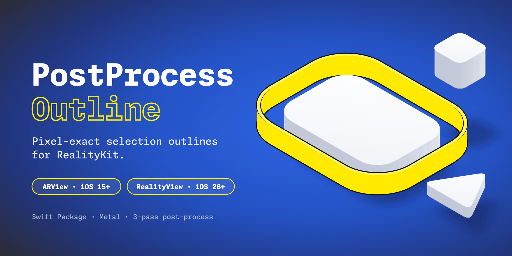

# PostProcessOutline

A RealityKit post-process effect that renders pixel-exact selection outlines around 3D objects using Metal.


> **Read the full write-up:** [RealityKit Outline Selection](https://elkraneo.com/realitykit-outline-selection/)

## Overview

This package provides a **post-process outline technique** for RealityKit that operates entirely in screen-space. Unlike traditional approaches (bounding boxes or inverted hulls), this method:

- Never touches the scene hierarchy
- Works at screen resolution regardless of mesh complexity
- Produces outlines of consistent pixel width
- Draws an X-ray outline: the full silhouette stays visible even when the object is behind other geometry

The X-ray behavior is deliberate for selection feedback — you always see what is selected. A depth-aware variant that hides occluded parts of the outline would need to test against the scene depth (`sourceDepthTexture`) and is a possible future option.

## Installation

Add the package with Swift Package Manager. In Xcode: **File › Add Package Dependencies…** and enter:

```
https://github.com/elkraneo/PostProcessOutline.git
```

Or in `Package.swift`:

```swift
dependencies: [
    // No tagged release yet — track main for now.
    .package(url: "https://github.com/elkraneo/PostProcessOutline.git", branch: "main"),
],
targets: [
    .target(
        name: "YourTarget",
        dependencies: [
            .product(name: "PostProcessOutline", package: "PostProcessOutline"),
        ]
    ),
]
```

## Architecture

The rendering lives in one core class with two thin front ends:

| Type | Availability | Use with |
|------|--------------|----------|
| `OutlineRenderer` | iOS 15+ / macOS 12+ | Core: selection, mesh upload, the three Metal passes |
| `OutlineRenderer.install(on:)` | iOS 15+ / macOS 12+ | `ARView` (UIKit / AppKit) via `renderCallbacks` |
| `PostProcessOutlineEffect` | iOS 26+ / macOS 26+ | `RealityView` (SwiftUI) via `PostProcessEffect` |

Not available on visionOS — neither `ARView` nor `PostProcessEffect` exist there.

## How It Works

The outline is rendered in **three passes**, either from `ARView.renderCallbacks.postProcess` or from `PostProcessEffect.postProcess`:

### Pass 1: Silhouette Mask
Renders the selected mesh into a single-channel `R8Unorm` texture. Every pixel covered by the mesh becomes white.

```metal
vertex float4 outlineMaskVertex(
    const device float3* positions [[buffer(0)]],
    constant MaskUniforms& u [[buffer(1)]],
    uint vid [[vertex_id]]
) {
    return u.mvp * float4(positions[vid], 1.0);
}

fragment float4 outlineMaskFragment(float4 position [[position]]) {
    return float4(1.0);
}
```

### Pass 2: Dilation
Expands the mask outward by `radius` pixels. Pixels outside the mesh but within range of the silhouette edge become white. Interior pixels are explicitly suppressed to zero, creating a ring at the boundary only.

```metal
kernel void outlineDilate(
    texture2d<float, access::read>  maskTex [[texture(0)]],
    texture2d<float, access::write> edgeTex [[texture(1)]],
    constant int32_t& radius [[buffer(0)]],
    uint2 gid [[thread_position_in_grid]]
)
```

### Pass 3: Composite
Blends the outline color over the source frame wherever the edge ring is set.

```metal
kernel void outlineComposite(
    texture2d<float, access::read>  sourceColor [[texture(0)]],
    texture2d<float, access::read>  edgeMask [[texture(1)]],
    texture2d<float, access::write> targetColor [[texture(2)]],
    constant float4& outlineColor [[buffer(0)]],
    uint2 gid [[thread_position_in_grid]]
)
```

## Requirements

- iOS 15.0+ / macOS 12.0+ for `OutlineRenderer` and the `ARView` adapter
- iOS 26.0+ / macOS 26.0+ for `PostProcessOutlineEffect` (`RealityView`)
- Xcode 26.0+
- Swift 6

> Testing so far: both paths verified running on macOS 27; iOS builds against the iOS 27 SDK but hasn't been run on a device yet. Support for iOS 15–25 (and macOS 12–26) is compile-verified only.

## Usage

### RealityView (SwiftUI, iOS 26+ / macOS 26+)

The effect needs the camera's view matrix and the selected entities' world transforms every frame, so subscribe to `SceneEvents.Update` and keep the subscription alive.

```swift
import RealityKit
import SwiftUI
import PostProcessOutline

@available(macOS 26.0, iOS 26.0, *)
struct ContentView: View {
    @State private var effect = PostProcessOutlineEffect(color: .yellow, radius: 3)
    @State private var camera = Entity()
    @State private var updates: EventSubscription?

    var body: some View {
        RealityView { content in
            // Setup camera
            camera.components.set(PerspectiveCameraComponent())
            camera.position = [0, 0.5, 1.5]
            content.add(camera)

            // Load model
            if let model = try? await Entity(named: "gramophone") {
                model.generateCollisionShapes(recursive: true)
                model.components.set(InputTargetComponent(allowedInputTypes: .all))
                content.add(model)
            }

            // Keep the outline aligned with the camera and moving entities
            updates = content.subscribe(to: SceneEvents.Update.self) { [effect, camera] _ in
                effect.setViewMatrix(camera.transformMatrix(relativeTo: nil).inverse)
                effect.updateTransforms()
            }

            content.renderingEffects.customPostProcessing = .effect(effect)
        }
        .gesture(
            TapGesture()
                .targetedToAnyEntity()
                .onEnded { value in
                    effect.setSelection(value.entity)
                }
        )
    }
}
```

### ARView (UIKit, iOS 15+)

`install(on:)` wires up `renderCallbacks` and a per-frame update subscription for you. Keep the returned `Cancellable`; calling `cancel()` removes everything.

```swift
import Combine
import RealityKit
import UIKit
import PostProcessOutline

final class OutlineViewController: UIViewController {
    private let arView = ARView(frame: .zero, cameraMode: .nonAR, automaticallyConfigureSession: false)
    private let outline = OutlineRenderer(cgColor: UIColor.systemYellow.cgColor, radius: 3)
    private var outlineInstallation: (any Cancellable)?

    override func viewDidLoad() {
        super.viewDidLoad()
        arView.frame = view.bounds
        arView.autoresizingMask = [.flexibleWidth, .flexibleHeight]
        view.addSubview(arView)

        let anchor = AnchorEntity(world: .zero)
        if let model = try? Entity.load(named: "gramophone") {
            model.generateCollisionShapes(recursive: true)   // needed for entity(at:)
            anchor.addChild(model)
        }
        let camera = PerspectiveCamera()
        camera.position = [0, 0.5, 1.5]
        anchor.addChild(camera)
        arView.scene.addAnchor(anchor)

        outlineInstallation = outline.install(on: arView)

        arView.addGestureRecognizer(
            UITapGestureRecognizer(target: self, action: #selector(handleTap(_:)))
        )
    }

    @objc private func handleTap(_ recognizer: UITapGestureRecognizer) {
        let point = recognizer.location(in: arView)
        outline.setSelection(arView.entity(at: point))   // nil clears the selection
    }
}
```

> `install(on:)` **overwrites** any `prepareWithDevice` / `postProcess` callbacks already set on `arView.renderCallbacks`. If you need your own post-processing too, skip `install(on:)` and call `prepare(device:)` / `encode(device:commandBuffer:source:target:projection:)` from your own callbacks, plus `setViewMatrix(_:)` and `updateTransforms()` every frame.

On macOS the same `install(on:)` call works with AppKit's `ARView`; only the click handling differs.

## API

### `OutlineRenderer`

| Member | Description |
|--------|-------------|
| `init(color: SIMD4<Float> = [1, 1, 0, 1], radius: Int = 3)` | RGBA color, thickness in pixels |
| `init(cgColor: CGColor, radius: Int = 3)` | Color converted to sRGB components |
| `color: SIMD4<Float>` | Live-updatable; takes effect on the next frame |
| `radius: Int` | Live-updatable; takes effect on the next frame. Clamped to `0...maxRadius` (64) |
| `setSelection(_ entity: Entity?)` | Select one entity (`nil` clears). Extracts mesh geometry and queues it for GPU upload |
| `setSelection(_ entities: [Entity])` | Multi-selection; all silhouettes share one outline |
| `preloadGeometry(of entities: [Entity])` | Reads and caches mesh geometry ahead of time, so the first selection doesn't hitch. Call after loading selectable entities |
| `updateTransforms()` | Re-reads world transforms of the selected entities. Call once per frame so moving objects stay outlined |
| `setViewMatrix(_ matrix: simd_float4x4)` | Camera view matrix (inverse of the camera's world transform). Call once per frame |
| `install(on arView: ARView) -> any Cancellable` | `ARView` adapter, see above |
| `prepare(device:)`, `encode(device:commandBuffer:source:target:projection:)` | Low-level hooks for custom render pipelines |

Selection and `updateTransforms()` are `@MainActor`; the renderer is otherwise safe to touch from the render thread.

### `PostProcessOutlineEffect` (iOS 26+ / macOS 26+)

A `PostProcessEffect` wrapper around an `OutlineRenderer`.

| Member | Description |
|--------|-------------|
| `init(color: Color = .yellow, radius: Int = 3)` | Creates its own renderer |
| `init(renderer: OutlineRenderer)` | Wraps an existing renderer |
| `renderer` | The underlying `OutlineRenderer` |
| `radius: Int` | Live-updatable, clamped to `0...64` |
| `setColor(_ color: Color)` | Live-updatable |
| `setSelection(_:)`, `preloadGeometry(of:)`, `updateTransforms()`, `setViewMatrix(_:)` | Forward to the renderer |

## Mesh Extraction

The renderer extracts geometry from `MeshResource.contents`, which provides direct access to:

- Vertex positions
- Triangle indices
- Instance transforms

Selecting an entity outlines its own mesh and every mesh below it in the hierarchy, as one silhouette. Entities that are removed from the scene or disabled stop contributing to the outline.

No buffer unwinding or topology reconstruction required. Geometry is uploaded once when the selection changes; after that only the model matrices (owner's current world transform × instance transform) are refreshed by `updateTransforms()`. There is also a fallback path for procedurally generated meshes via `LowLevelMesh` (iOS 18+ / macOS 15+, `float3` positions).

## Performance Notes

- When nothing is selected, a simple blit copy runs instead of the three passes — idle overhead is effectively zero
- Reading a mesh's geometry from RealityKit is slow (~100 ms for a 46k-vertex model) and must happen on the main actor. It's done once per entity and cached, so call `preloadGeometry(of:)` at load time; selections after that take about a millisecond
- Mask, depth and edge textures are cached and only reallocated when the output size changes
- The dilation pass checks up to a (2r+1)² neighborhood per outside pixel, so its cost grows with radius². Fine for the small radii an outline needs; large radii would want a separable or jump-flood approach

## Examples

`Examples/PostProcessOutlineExample.xcodeproj` is a small app that depends on the local package and shows both front ends side by side: the `RealityView` + `PostProcessOutlineEffect` demo and the `ARView` + `install(on:)` demo, using the same gramophone model.

## Why Not Other Techniques?

| Technique | Issues |
|-----------|--------|
| **Bounding Box** | Clips mesh or floats away; conveys location, not shape |
| **Inverted Hull** | Breaks on concavities, non-uniform scale, extreme model sizes |
| **Post-Process** | Consistent pixel width, handles all geometry correctly |

## Related

- [Blog Post: RealityKit Outline Selection](https://elkraneo.com/realitykit-outline-selection/)
- [PostProcessEffect | Apple Developer Documentation](https://developer.apple.com/documentation/realitykit/postprocesseffect)

## License

MIT License — See [LICENSE](LICENSE) for details.
