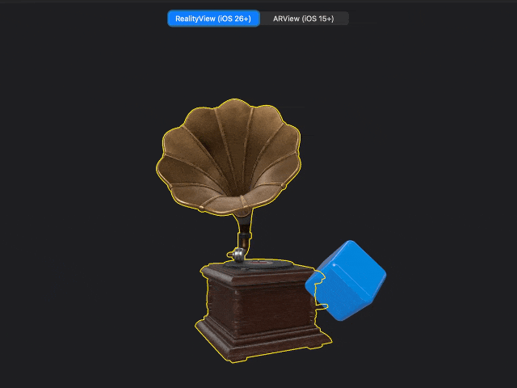

Pixel-exact selection outlines for RealityKit, as a Metal post-process. Constant pixel width, follows moving entities, supports multi-selection, and never touches your scene. [How it works →](https://elkraneo.com/realitykit-outline-selection/)



## Install

```swift
.package(url: "https://github.com/elkraneo/PostProcessOutline.git", from: "1.1.0")
```

## ARView (UIKit / AppKit, iOS 15+)

```swift
let outline = OutlineRenderer(cgColor: UIColor.systemYellow.cgColor, radius: 3)
let installation = outline.install(on: arView)  // keep alive; replaces arView.renderCallbacks
outline.setSelection(arView.entity(at: point))  // nil clears
```

## RealityView (SwiftUI, iOS 26+)

```swift
@State private var effect = PostProcessOutlineEffect(color: .yellow, radius: 3)

RealityView { content in
    updates = content.subscribe(to: SceneEvents.Update.self) { _ in  // every frame
        effect.setViewMatrix(camera.transformMatrix(relativeTo: nil).inverse)
        effect.updateTransforms()
    }
} update: { content in
    content.renderingEffects.customPostProcessing = .effect(effect)
}
effect.setSelection(entity)
```

Set the effect in `update:`. Setting it in the make closure can crash inside RealityKit when the view is hosted with `NSHostingView`.

## Notes

- Call `preloadGeometry(of:)` after loading selectable entities. The first mesh read is slow (~100 ms for 46k vertices); selection is ~1 ms after that. For content edited in place (e.g. a live USD stage), set `cachesGeometry = false`.
- `meshSelection` picks which meshes in a hierarchy are outlined: everything (default), the nearest meshes, or descendants first (for USD prims carrying aggregate meshes).
- `color` and `radius` (0…64) can change live.
- The outline is X-ray style: it stays visible behind other geometry.
- iOS, macOS and tvOS 26+; not on visionOS. Run-tested on macOS 27; other platforms are build-tested.

See [`Examples/`](Examples) for a working app with both versions.
